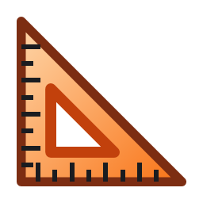

<p align="center">
  <picture>
    <source media="(prefers-color-scheme: dark)" srcset="assets/package/AppList.targetsize-256_altform-unplated.png">
    
  </picture>
</p>

<h1 align="center">
  <picture>
    <source media="(prefers-color-scheme: dark)" srcset="assets/readme/wordmark-dark.svg">
    
  </picture>
</h1>

<p align="center">Measure anything on your screen, pixel by pixel.</p>

<p align="center"><b>English</b> · <a href="README.pt-BR.md">Português</a></p>

ScreenGauge is a free, open-source screen ruler for Windows 11. Press **Win + Shift + X**: it freezes everything on your monitors and opens a toolbar with four tools.

- **Dimensions** measures the gap around the cursor, from the nearest edge on one side to the nearest edge on the other: horizontally, vertically, or both at once.
- **Bounds** shrinks a rectangle you drag until it fits the content inside it.
- **Inspect** magnifies the area around the cursor and shows the cursor's position and the exact color of the pixel under it, in HEX, RGB, or both.
- **Snip** captures the content inside a rectangle you drag as a PNG, to the clipboard, a file, or both.

Every number is in physical pixels, with logical pixels next to it when the monitor's scale isn't 100% (Settings can turn that off). A click copies the number or the color.

## Install

### Microsoft Store (recommended)

[Get ScreenGauge from the Microsoft Store](https://apps.microsoft.com/detail/9PGNSRZ2BPJ2). The Store keeps it up to date.

From a terminal, the same Store app installs with:

```
winget install --id 9PGNSRZ2BPJ2 --source msstore
```

### Installer from GitHub

Each version on the [Releases page](https://github.com/carreirodev/screengauge/releases/latest) has an installer, `ScreenGauge-<version>-setup.exe`. It installs ScreenGauge for your Windows user only, with no administrator password, adds it to the Start menu, and uninstalls from Settings > Apps > Installed apps.

> [!NOTE]
> Windows may warn you because this installer isn't signed yet. If Smart App Control is on, Windows blocks it; install ScreenGauge from the Microsoft Store instead.

This copy doesn't update itself: **Check for updates**, at the bottom of Settings, tells you when a new version is out. If ScreenGauge is already installed from the Microsoft Store, the installer tells you and recommends canceling, so you don't end up with two copies.

## Using ScreenGauge

- **Open the tools** with Win + Shift + X, a click on ScreenGauge's icon next to the clock, or ScreenGauge in the Start menu. You can change the shortcut in Settings.
- **Switch tools** with the toolbar or the keys 1 to 4. In Dimensions, H, V and C pick horizontal, vertical or both.
- **Close the tools** with Esc, the shortcut again, the toolbar's close button, or by switching to another program.
- **Click** in Dimensions, or release the drag in Bounds, to pin the measurement on screen and copy its number; with Shift, it copies logical pixels instead. Backspace or Delete removes the last pinned measurement.
- **Click in Inspect** to copy the color. When both HEX and RGB are shown, a click copies HEX and Shift + click copies RGB.
- **Hold Alt** while dragging in Bounds or Snip to use the rectangle exactly as drawn.
- **The mouse wheel** sets the tolerance in Dimensions, Bounds and Snip (how different a color must be to count as an edge), and the magnification in Inspect.
- **The arrow keys** move the cursor 1 pixel at a time, or 10 with Shift.
- **Settings** opens from the gear on the toolbar, or with a right-click on ScreenGauge's icon next to the clock.

The screen stays frozen while the tools are open. To measure something that changed, close the tools and open them again.

## Known limitations

- **Protected content.** Video from streaming services, and windows that protect themselves from screen capture, may come out black or be missing from the frozen screen, and so from measurements, colors and Snips.
- **"Approximate color (HDR on)".** With HDR on, Windows brightens the colors apps draw, and ScreenGauge undoes it, so Inspect shows the color the app drew. When it can't undo it on a monitor, Inspect shows "Approximate color (HDR on)" under the color: the color shown may differ from the one the app drew. In rare cases, ScreenGauge can't tell that HDR is on, and the color may differ without that notice.
- **Rotated monitor with HDR on.** On a monitor turned to portrait or upside down in Windows' display settings, with HDR on, Inspect always shows "Approximate color (HDR on)": ScreenGauge photographs a rotated monitor another way, which doesn't guarantee the color the app drew.
- **HDR content.** Video, games and pictures brighter or more saturated than any standard color have no exact standard color. Inspect shows the nearest standard color, and Snip clips their brightest parts to white.
- **One monitor at a time.** Each tool works on the monitor under the cursor, so a window that sits across two monitors can't be measured or snipped as one.

## Privacy

ScreenGauge collects nothing and has no account. It goes to the internet only when you click **Check for updates** in the copy installed from GitHub. Read the [privacy policy](https://wpcsolutions.com.br/screengauge/privacy/).

## Requirements

Windows 11, 64-bit (x64).

## Building from source

With [Rust](https://rustup.rs) installed, `rust-toolchain.toml` picks the Rust version:

```
cargo build --release
```

The program is `target\release\ScreenGauge.exe`. The Microsoft Store package and the GitHub installer are built by the scripts in [`packaging`](packaging).

## License

[MIT](LICENSE). ScreenGauge is published by WPC Solutions.
