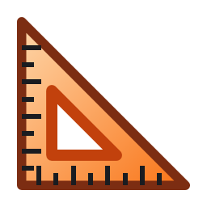

<p align="center">
  <picture>
    <source media="(prefers-color-scheme: dark)" srcset="assets/package/AppList.targetsize-256_altform-unplated.png">
    
  </picture>
</p>

<h1 align="center">
  <picture>
    <source media="(prefers-color-scheme: dark)" srcset="assets/readme/wordmark-dark.svg">
    
  </picture>
</h1>

<p align="center">Meça qualquer coisa na tela, pixel por pixel.</p>

<p align="center"><a href="README.md">English</a> · <b>Português</b></p>

O ScreenGauge é uma régua de tela gratuita e de código aberto para o Windows 11. Aperte **Win + Shift + X**: ele congela tudo o que está nos monitores e abre uma barra com quatro ferramentas. O app é só em inglês, então os nomes das ferramentas e dos botões aparecem aqui como na tela.

- **Dimensions** mede o vão em volta do cursor, da borda mais próxima de um lado à mais próxima do outro: na horizontal, na vertical ou nas duas ao mesmo tempo.
- **Bounds** encolhe o retângulo que você arrasta até ele caber no conteúdo de dentro.
- **Inspect** amplia a área em volta do cursor e mostra a posição dele e a cor exata do pixel embaixo, em HEX, RGB ou nos dois.
- **Snip** captura como PNG o conteúdo do retângulo que você arrasta, para a área de transferência, para um arquivo ou para os dois.

Todo número sai em pixels físicos, com os pixels lógicos ao lado quando a escala do monitor não é 100%. Um clique copia o número ou a cor.

## Instalação

### Microsoft Store (recomendada)

[Baixe o ScreenGauge na Microsoft Store](https://apps.microsoft.com/detail/9PGNSRZ2BPJ2). A Store mantém o app atualizado.

Pelo terminal, o mesmo app da Store se instala com:

```
winget install --id 9PGNSRZ2BPJ2 --source msstore
```

### Instalador do GitHub

Cada versão na [página de Releases](https://github.com/carreirodev/screengauge/releases/latest) tem um instalador, `ScreenGauge-<versão>-setup.exe`. Ele instala o ScreenGauge só para o seu usuário do Windows, sem senha de administrador, coloca o app no menu Iniciar e se desinstala em Configurações > Aplicativos > Aplicativos instalados.

> [!NOTE]
> O Windows pode mostrar um alerta, porque este instalador ainda não é assinado. Com o Controle Inteligente de Aplicativos (Smart App Control) ligado, o Windows o bloqueia; nesse caso, instale o ScreenGauge pela Microsoft Store.

Esta cópia não se atualiza sozinha: **Check for updates**, no rodapé de Settings, avisa quando sai uma versão nova. Se o ScreenGauge já estiver instalado pela Microsoft Store, o instalador avisa e recomenda cancelar, para você não ficar com duas cópias.

## Como usar

- **Abra as ferramentas** com Win + Shift + X, com um clique no ícone do ScreenGauge perto do relógio ou pelo ScreenGauge no menu Iniciar. O atalho pode ser trocado em Settings.
- **Troque de ferramenta** pela barra ou pelas teclas 1 a 4. No Dimensions, H, V e C escolhem horizontal, vertical ou as duas.
- **Feche as ferramentas** com Esc, com o atalho de novo, com o botão de fechar da barra ou passando para outro programa.
- **Clique** no Dimensions, ou solte o arraste no Bounds, para fixar a medida na tela e copiar o número; segure Shift para copiar os pixels lógicos. Backspace apaga a última medida fixada. No Inspect, o clique copia a cor.
- **Segure Alt** durante o arraste no Bounds ou no Snip para usar o retângulo exatamente como foi desenhado.
- **A roda do mouse** ajusta a tolerância no Dimensions, no Bounds e no Snip (o quanto uma cor precisa diferir para contar como borda) e a ampliação no Inspect.
- **As setas** movem o cursor 1 pixel por vez, ou 10 com Shift.
- **Settings** abre pela engrenagem da barra ou com o botão direito no ícone do ScreenGauge perto do relógio.

A tela fica congelada enquanto as ferramentas estão abertas. Para medir algo que mudou, feche as ferramentas e abra de novo.

## Limitações conhecidas

- **Conteúdo protegido.** Vídeo de serviços de streaming e janelas que se protegem contra captura de tela podem sair pretos ou sumir da tela congelada e, com isso, das medidas, das cores e dos Snips.
- **"Approximate color (HDR on)".** Com o HDR ligado, o Windows clareia as cores que os apps pintam, e o ScreenGauge desfaz esse clareamento, para o Inspect mostrar a cor que o app pintou. Quando não consegue desfazer num monitor, o Inspect mostra "Approximate color (HDR on)" embaixo da cor: a cor mostrada pode diferir da que o app pintou. Em casos raros, o ScreenGauge não consegue saber que o HDR está ligado, e a cor pode sair diferente sem esse aviso.
- **Conteúdo HDR.** Vídeos, jogos e imagens mais claros ou mais saturados que qualquer cor padrão não têm uma cor padrão exata. O Inspect mostra a cor padrão mais próxima, e o Snip corta as partes mais claras para branco.
- **Um monitor de cada vez.** Cada ferramenta trabalha no monitor que está sob o cursor, então uma janela que fica metade em cada monitor não pode ser medida nem capturada inteira.

## Privacidade

O ScreenGauge não coleta nada e não tem conta. Ele só acessa a internet quando você clica em **Check for updates** na cópia instalada pelo GitHub. Leia a [política de privacidade](https://wpcsolutions.com.br/screengauge/privacy/) (em inglês).

## Requisitos

Windows 11, 64 bits (x64).

## Compilar a partir do código

Com o [Rust](https://rustup.rs) instalado, o `rust-toolchain.toml` escolhe a versão do Rust:

```
cargo build --release
```

O programa é `target\release\ScreenGauge.exe`. O pacote da Microsoft Store e o instalador do GitHub são gerados pelos scripts em [`packaging`](packaging).

## Licença

[MIT](LICENSE). O ScreenGauge é publicado pela WPC Solutions.
